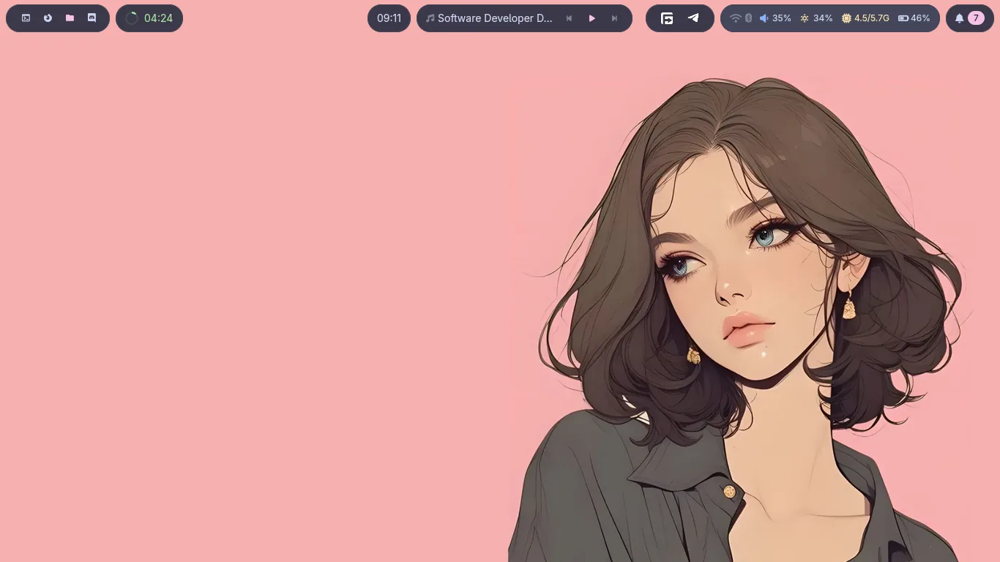
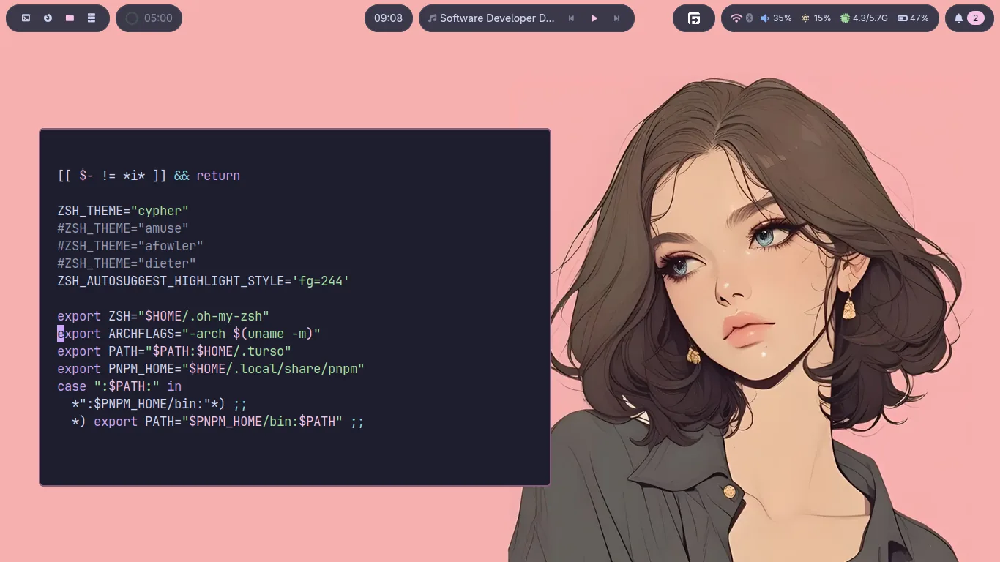
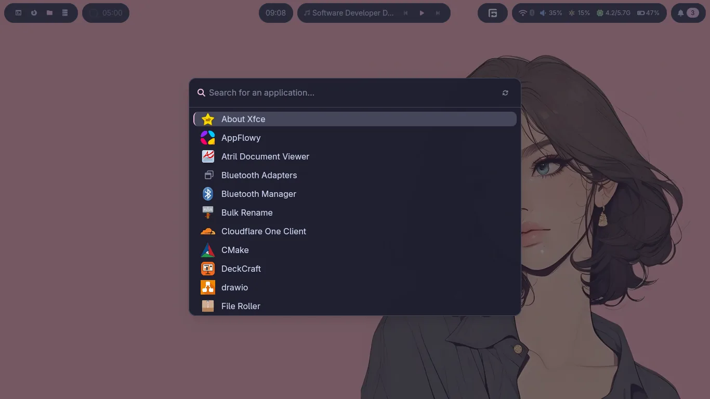
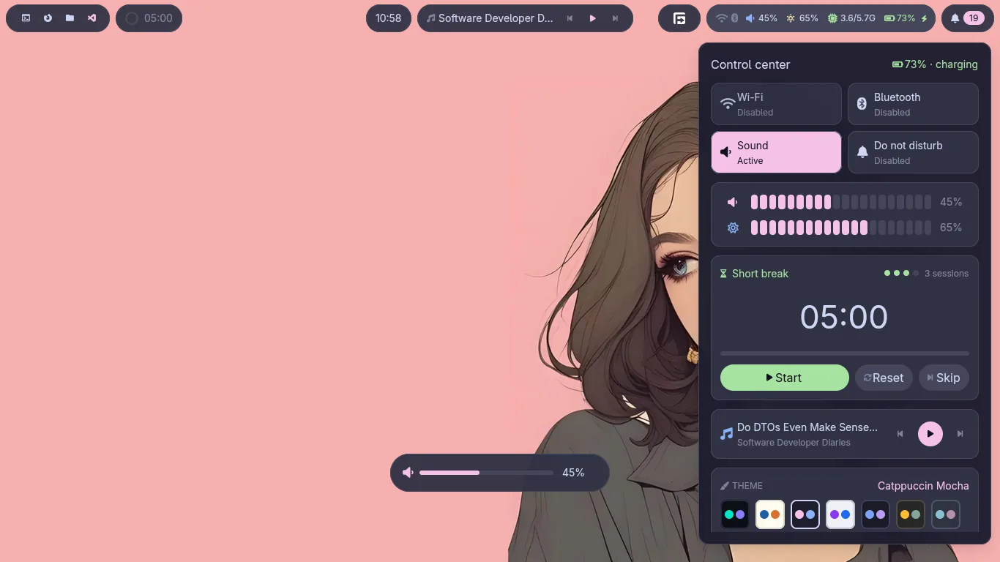
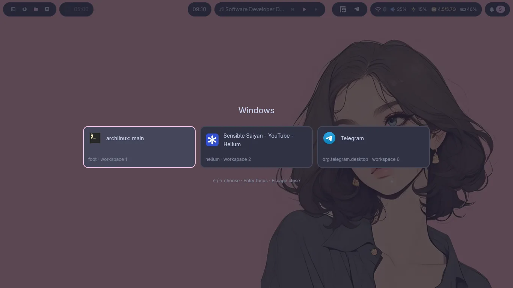
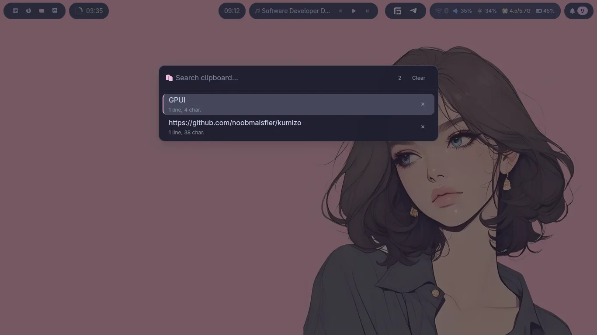
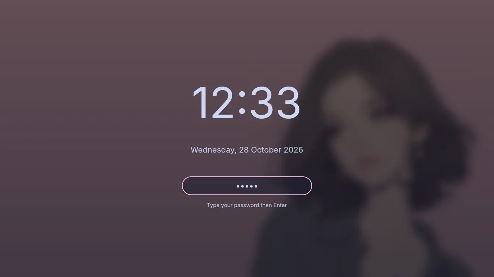

# id-86

Light, fast, focused.
A minimal Sway rice for Arch Linux and Debian.

## Screenshots


<details>
<summary>All screenshots</summary>

| | |
|---|---|
| **Desktop**<br> | **Terminal**<br> |
| **Launcher**<br> | **Control center**<br> |
| **Window switcher**<br> | **Clipboard**<br> |
| **Lockscreen**<br> | |

</details>

## Installation

```bash
curl -fsSL https://github.com/noobmaisfier/A28/archive/refs/heads/main.tar.gz | tar xz -C /tmp \
  && cd /tmp/A28-main && chmod +x setup.sh && ./setup.sh
```

During the installation, two questions are asked:

- **swayfs**: should it be installed? If another sway compositor is already
  present, it offers to replace it — no by default.
  (swayfs is a fork I maintain, aiming to be lighter and more minimal.)

- **Neovim**: should the rice config be installed? If `~/.config/nvim` already
  exists, it offers to keep it — no by default.

To script the answers:

```bash
ID86_SWAYFS=1|0 ID86_NVIM=1|0 ./setup.sh
```

## `setup.sh` or `me.sh`?

`setup.sh` installs the base rice: packages, AUR, Rust, Node, swayfs, awww,
dotfiles, the shell, zsh, fonts, themes, Bluetooth and iwd. At the end,
`postinstall.sh` finishes the parts that need a live session: vim plugins,
nvim plugins + Mason, sway reload, XDG directories.

`me.sh` is `setup.sh` plus my personal stuff. It is not run by default.

Existing configs are backed up to `~/.backup-id-86/<date>`.

## Themes

The default theme is **mocha**. To switch:

```bash
change-theme mocha
change-theme list
change-theme toggle
```

`Super+Shift+t` also opens the shell's theme picker.

Available themes: `mocha`, `flexoki-light`, `aurora`, `github-light`, `nord`,
`tokyo-night`, `gruvbox-dark`.

`change-theme` updates sway, foot, yazi, vim, nvim, GTK, the wallpaper, fzf and
herdr. Running foot instances reload their colors live (SIGUSR1); font,
padding and keybind changes still need a restart.

## Customizing the shell

The shell is built on the [kumizo](https://github.com/noobmaisfier/kumizo) SDK.
Its source is vendored in `dotfiles/share/shell/kumi/` and installed to
`~/.local/share/shell/kumi`; `setup.sh` replaces that copy on every install
(backup in `~/.backup-id-86/<date>/share-shell`) and rebuilds it if needed.

To modify or extend kumi, see the upstream docs:
- [kumizo Guide](https://github.com/noobmaisfier/kumizo/blob/main/docs/GUIDE.md)
- [kumizo API](https://github.com/noobmaisfier/kumizo/blob/main/docs/API.md)

After editing the source, rebuild and restart the shell:

```bash
~/.local/share/shell/update               # build + install + restart
~/.local/share/shell/update --no-restart  # build only
```

The palettes live in `kumi/src/theme.rs`, the windows and widgets in
`kumi/src/main.rs`. To change theme without rebuilding, use `change-theme` or
the shell's picker (`Super+Shift+t`); the choice is saved in
`~/.config/kumi/theme`.

## Secrets

API keys are not in the repository. They live in
`~/.config/id-86/secrets.sh`, loaded by `.zshrc`:

```bash
[ -f "$HOME/.config/id-86/secrets.sh" ] && . "$HOME/.config/id-86/secrets.sh"
```

The repository is public: never commit a key. `.gitignore` excludes
`secrets.sh` and `*.env`.

## A few shortcuts

- `Super+a`: launcher
- `Super+w`: windows
- `Super+c`: control center
- `Super+Shift+t`: theme picker
- `Super+p` / `Super+Shift+p`: next / previous wallpaper
- `Super+b`: bar

Media keys go through MPRIS (`playerctl play-pause`, for example).

## Links

- Releases: https://github.com/noobmaisfier/A28/releases
- Shell: `kumi`, `kumizo`, `kumi-lockscreen`, built from the vendored
  source in `dotfiles/share/shell/kumi` and installed in `~/.local/bin`.
